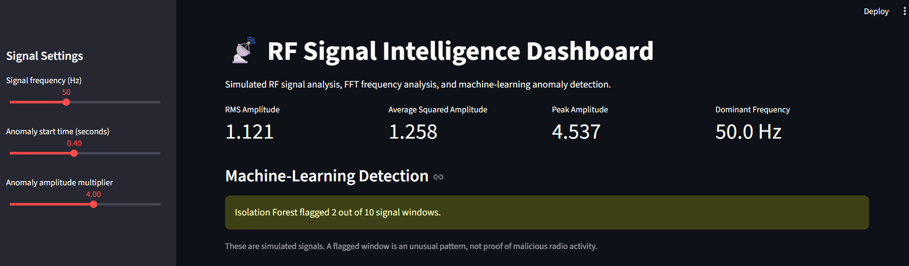
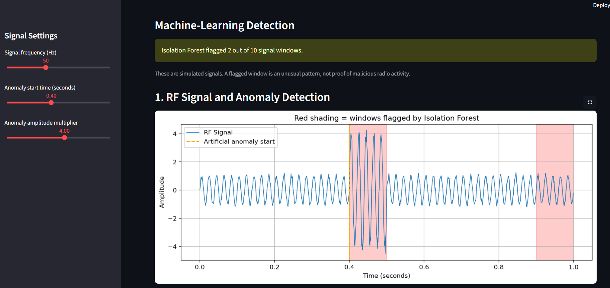
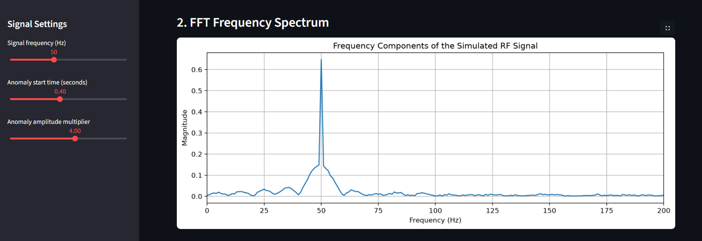
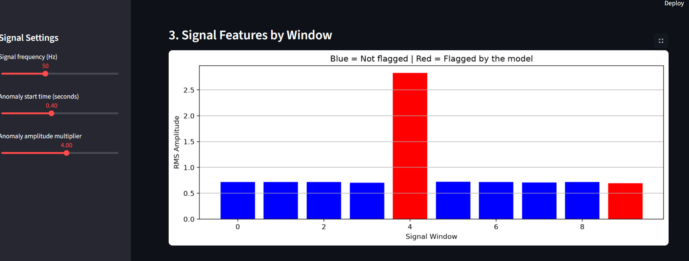
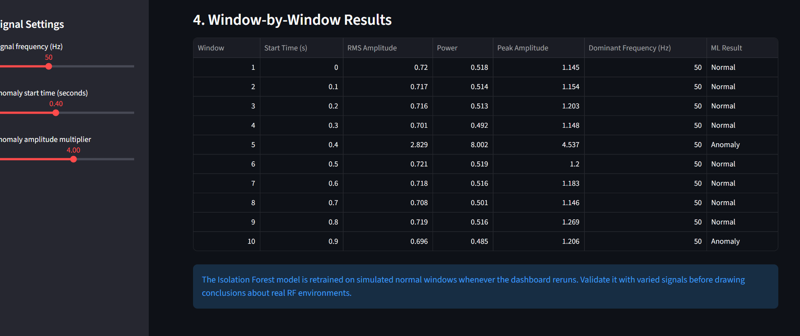

# RF Signal Intelligence and Anomaly Detection

## Project Overview
This project simulates RF (Radio Frequency) signals and detects unusual signal patterns using Python and machine learning.

It includes signal visualization, amplitude-based anomaly detection, FFT frequency analysis, Isolation Forest anomaly detection, and an interactive Streamlit dashboard.

## Features
- Simulated RF signal generation
- Artificial amplitude anomaly creation
- Threshold-based anomaly detection
- FFT frequency spectrum analysis
- Signal feature extraction: RMS, power, peak amplitude, and dominant frequency
- Isolation Forest machine-learning experiment
- Interactive dashboard with graphs and adjustable parameters

## Technologies Used
- Python
- NumPy
- Matplotlib
- Scikit-learn
- Streamlit

## Installation
Install Python, then open a terminal in the project folder and run:

```bash
python -m pip install -r requirements.txt
```

## Run the Dashboard
Run:

```bash
python -m streamlit run app.py
```

Open the local URL displayed in the terminal.

## Run the Standalone Experiments
Run the original signal simulation:

```bash
python main.py
```

Run the machine-learning experiment:

```bash
python ml_detector.py
```
## Dashboard Preview
## Project Screenshots

### Screenshot 1


### Screenshot 2


### Screenshot 3


### Screenshot 4


### Screenshot 5


## Important Note
The current project uses simulated RF signals and artificially created anomalies. It is an educational prototype, not a validated real-world RF monitoring or security system.

## Future Improvements
- Analyze real recorded RF data
- Compare multiple anomaly detection methods
- Evaluate performance on unseen test data
- Add downloadable analysis reports
